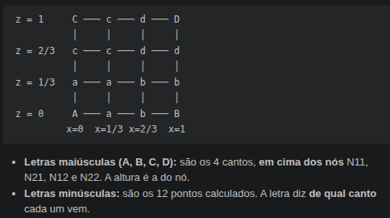
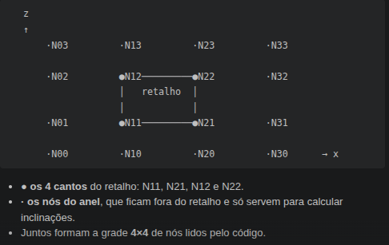

### Geração de terreno: 
Nosso terreno é gerado com superfícies de bézier bicúbicas. 
Em vez de 4 pontos de controles, temos 16, dos quais 4 são nós.
Os pontos cobrem um quadrado no chao, gerando um retalho.
Um retalho está para uma superfície assim como um segmento está para uma curva.

Visto de cima, o chão fica dividido num tabuleiro de pathces.
Cada nó recebe uma altura aleatória dentro do faixa possível e acontece gera a altura dos pontos de controle mais próximos somando sua inclinação/3 (pois é cúbica).

Contudo, surge o problema de quinas ENTRE diferentes retalhoes.
Solucao:  
    O código do cálculo de altura gera o terreno ponto a ponto, lendo os pontos correspondentes ao retalho do ponto escolhido junto dos nodos em volta desse retalho.

    
    Ex: Para suavizar a emenda quentre os patches os quais N12 pertence:

    1:  Calculamos a inclinação do nó N12 Dx(N12), que divide os dois retalhoes, usando a altura dos Nos adjecentes horizontalmentes N02 e N22.
    2: Somamos ou subtraímos Dx(N12)/3 aos pontos de controle adjecentes horizontalmente à N12.
    
    A mesma fórmula se aplica aos pontos de controle verticalmente adjecentes e diagonais aos nodos, que dependem de ambas derivadas em relação a X e Z.
    Dessa forma, a altura dos pontos de controle entre retalhoes ficam alinhadas, tornando as emendas suaves. 

### Gravidade e movimento:

O jogador tem dois estados: Com dive ou sem dive.
Dar dive aumenta o multiplicador gravitacional, enquanto não ter dive diminui.

Calculamos a inclinação do terreno pra onde o jogador aponta, em que slope > é subida e slope < 0 descida. Como a inclinação é relativa a onde estamos apontando, andar de lado em uma ladeira pode ser plano.

A aceleração causada pela gravidade é definida por 
-gravity * slope / sin(slope), o que gera ganho na descida e perda na subida. No divde, os efeitos de subida e descida ficam mais intensos devido ao multiplicador.

Existe um piso de velocidade para garantir que o jogador nunca fique parado.

No ar, a gravidade não afeta a velocidade horizontal, só a vertical.
Para dar a impressão de voo, existe a variável lift (planagem do pássaro), qeu reduz a força gravitacional conforme a velocidade de voo. Dar dive no ar anula a sustentação.

Decolagem: No chão, a cada frame, o código testa: "se a bola estivesse solta, sujeita só à gravidade, ela ainda estaria tocando no terreno?" Se sim, o pássaro entra em estado de voo. 
A velocidade é então decomposta em velocidade horizontal, que é constante, e velocidade vertical, que decai.

Aterrisagem: A velocidade é dividida entre a parte paralela à inclinação do terreno, que é mantida, e a parte perpendicular a ele, que é descartada. Isso resulta em uma redução de velocidade proporcional ao valor da derivada do terreno aterrisado.